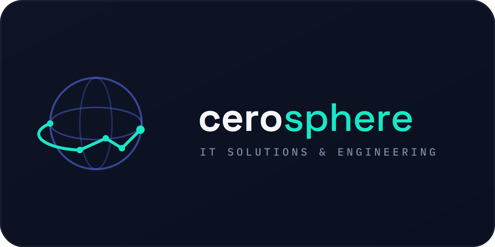
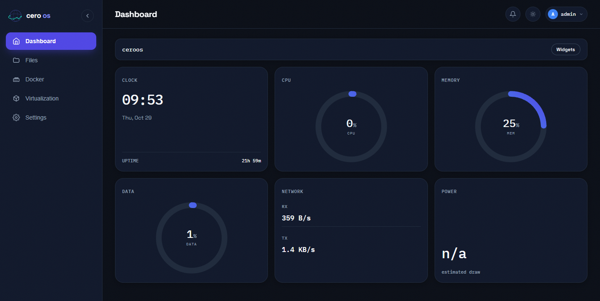
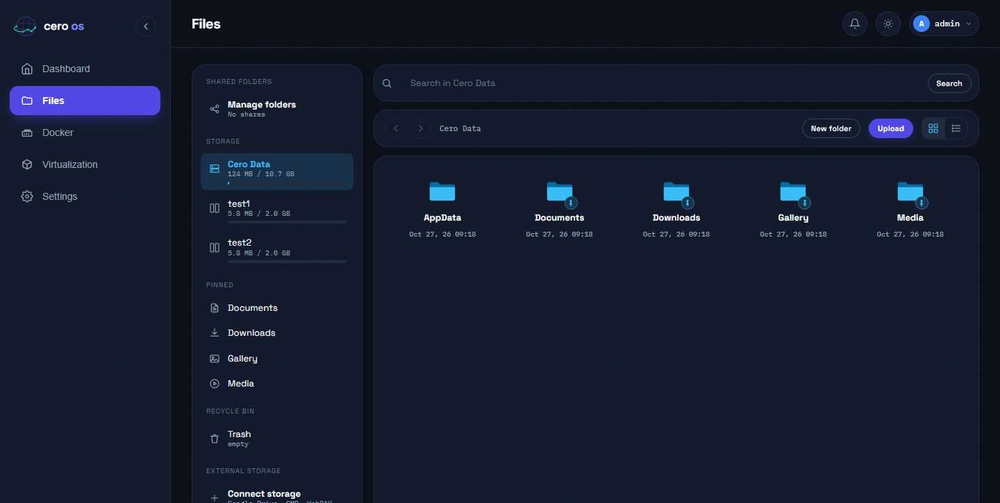
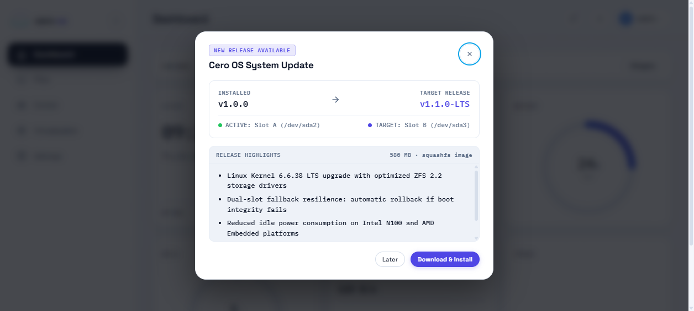

<p align="center">
  
</p>

<p align="center">
  <a href="https://github.com/cerosphere/CeroOS/releases"></a>
  <a href="https://github.com/cerosphere/CeroOS/releases"></a>
  <a href="https://ceroos.cerosphere.my.id/"></a>
  <a href="LICENSE"></a>
  <a href="https://paypal.me/wakdou"></a>
  <a href="https://sociabuzz.com/otatt"></a>
</p>

# Cero OS

**A lightweight, self-hosted appliance operating system designed for modern home labs, edge servers, and high-performance network-attached storage (NAS).**

Cero OS transforms commodity x86-64 hardware into an enterprise-grade, turnkey storage appliance. Engineered with atomic dual-slot A/B system updates, native OpenZFS data integrity, and an ultra-responsive industrial web console.

---

## Interface Showcase

### Central Dashboard & Telemetry
Real-time metrics streaming covering CPU load, memory utilization, ZFS storage volume pools, network throughput, and hardware health status.

<p align="center">
  
</p>

### Storage Pools & Integrated File Explorer
Manage native ZFS pool topology, dataset properties, compression, instant snapshots, and browse shared volume datasets.

<p align="center">
  
</p>

### Atomic Dual-Slot A/B OTA Updates
Safe, zero-downtime updates via Squashfs images written directly to the passive partition slot with automated bootloader watchdog rollback.

<p align="center">
  
</p>

---

## Key Features

- **Dual-Slot A/B OTA Architecture:** Upgrades flash to the inactive partition (`Slot A` / `Slot B`) in the background. If a new version fails boot checks, the GRUB bootloader watchdog immediately rolls back to the previous stable slot.
- **Enterprise OpenZFS Native:** End-to-end data checksumming, automatic bit rot recovery, transparent compression (LZ4/ZSTD), and scheduled automated scrubs.
- **Container Infrastructure:** Built-in Docker engine and container orchestrator to deploy self-hosted services alongside your storage pools.
- **Zero AI-Slop UI:** Industrial Swiss aesthetics, monospaced data alignment, zero decorative emojis, keyboard shortcuts, and dark mode design.
- **Minimal Footprint:** Lean appliance architecture boots in seconds and operates with minimal background CPU/RAM overhead.

---

## Supported Hardware (BYOH)

Cero OS supports standard 64-bit x86 hardware with UEFI firmware:

| Hardware Type | Example Platforms | Target Use Case |
|---|---|---|
| **Modern Mini PCs** | Intel N100 / N200 / N305, Beelink, Minisforum | Ultra-low power 24/7 personal NAS & media vault |
| **Edge & Compact Nodes** | Intel NUC, ASUS PN Series, Lenovo Tiny, HP ProDesk | Silent home lab nodes, offsite backup targets |
| **Custom Tower / Rackmount** | AMD Ryzen, Intel Core i3/i5/i7, Xeon E3/E5 | Multi-drive ZFS arrays (4 to 24+ SAS/SATA bays) |
| **Virtual Environments** | Proxmox VE, VMware ESXi, KVM / QEMU | Staging environments, testbeds, and virtual appliances |

### Recommended Hardware Specifications

- **Processor:** 64-bit x86 CPU (Intel N-series, Core i3+, AMD Ryzen)
- **Memory:** 4 GB RAM minimum (8 GB+ recommended for ZFS ARC caching and Docker workloads)
- **Boot Device:** 16 GB+ SSD / NVMe (dedicated to dual-slot system OS)
- **Storage Drives:** 1 or more dedicated HDDs / SSDs for ZFS pools

---

## Getting Started & Installation

### 1. Preparation
- Ensure the target system supports **64-bit x86 UEFI Boot**.
- Access system BIOS/UEFI settings and **disable Secure Boot**.
- Back up any existing data on the target storage drives. Installing Cero OS will format the selected boot disk.

### 2. Download the Installer
Download the latest bootable ISO image from **[GitHub Releases](https://github.com/cerosphere/CeroOS/releases)**:
- `cero-installer-v*.iso`: Standalone bare-metal installer image.
- `sha256sums.txt`: Checksum file to verify download authenticity.

### 3. Flash to USB Installation Media

Use **[Balena Etcher](https://etcher.balena.io/)** to write the installer to a USB flash drive (8 GB or larger):

1. Insert your USB flash drive into your workstation.
2. Launch Balena Etcher.
3. Select the downloaded `cero-installer-v*.iso` image file.
4. Select the target USB flash drive as the destination.
5. Click **Flash!** / **Start** and wait for write verification to complete.
6. Safely eject the USB drive.

### 4. Install Cero OS
1. Insert the USB drive into your target appliance machine.
2. Power on the machine and press the Boot Menu key (`F11`, `F12`, `F8`, or `Esc` depending on motherboard).
3. Select your USB drive in **UEFI Mode** from the boot menu.
4. Follow the on-screen installer:
   - Select your target boot drive (e.g., `/dev/nvme0n1` or `/dev/sda`).
   - Confirm disk initialization (installer provisions EFI, Slot A, Slot B, and data partitions).
   - Once installation completes, remove the USB installation drive.
   - Reboot the machine.

### 5. First Boot & Web Console Access
1. Cero OS will boot into the primary active partition slot.
2. The system console screen will display the assigned local IP address (e.g., `http://192.168.1.100`).
3. Open a browser on any device in the same network and navigate to:
   ```
   http://<YOUR_CERO_OS_IP>/
   ```
4. Sign in with the default administrative credentials or complete the initial setup wizard to start configuring storage pools.

---

## Support & Donate for Coffee

If Cero OS accelerates your workflow or powers your home lab infrastructure, support continued engineering and infrastructure hosting:

- **PayPal (International):** [paypal.me/wakdou](https://paypal.me/wakdou)
- **SociaBuzz (Indonesia / QRIS / E-Wallet):** [sociabuzz.com/otatt](https://sociabuzz.com/otatt)

---

## Community & Feedback

- **Official Website:** [https://ceroos.cerosphere.my.id/](https://ceroos.cerosphere.my.id/)
- **Bug Reports & Feedback:** Open a ticket on the [Issues](https://github.com/cerosphere/CeroOS/issues) tab.

---

## License

Copyright &copy; 2026 Cerosphere. All Rights Reserved.

Cero OS pre-compiled binaries and official release media are distributed for personal, home lab, and authorized organizational use on your own hardware. The underlying software source code is proprietary. See the [LICENSE](LICENSE) file for terms and limitations.
